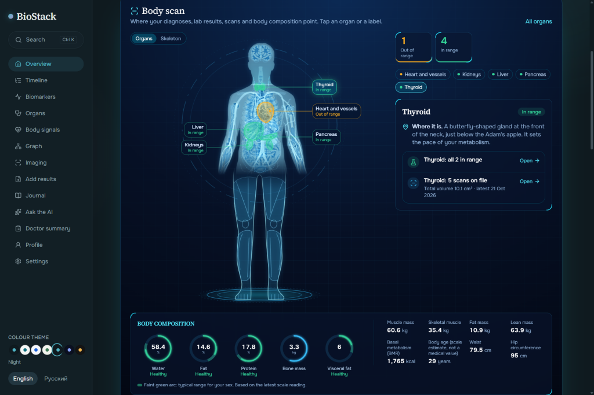
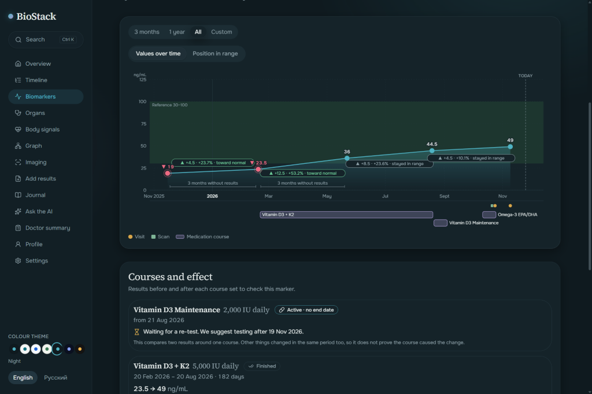
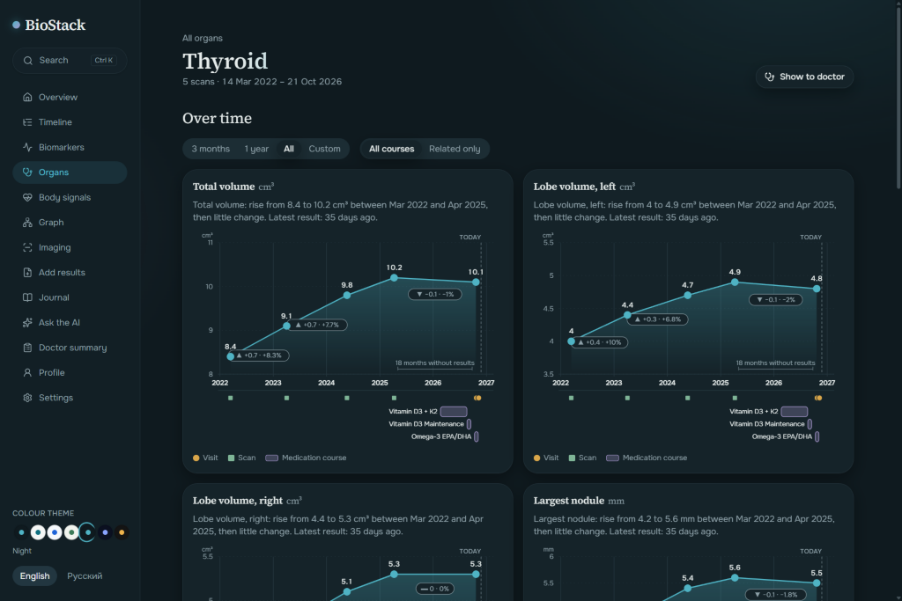
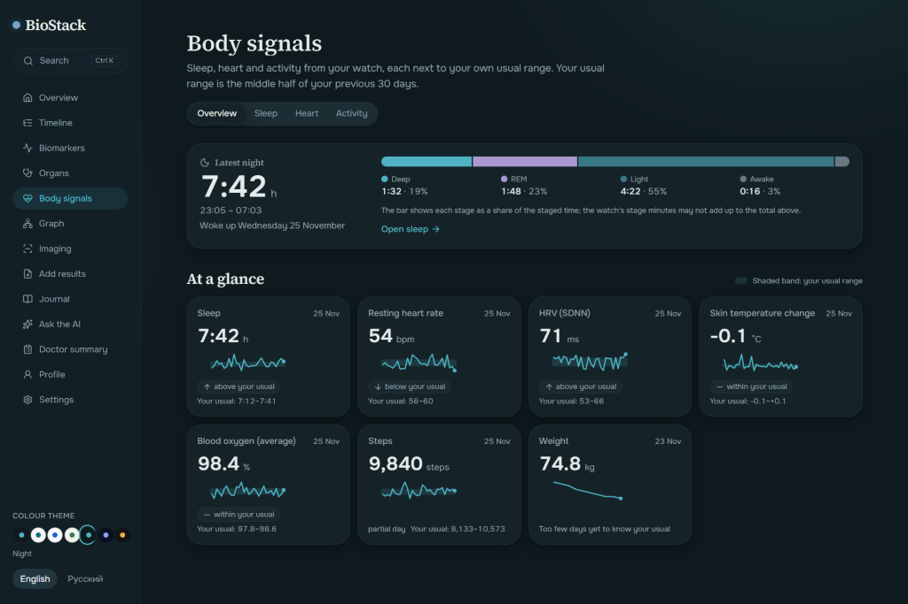
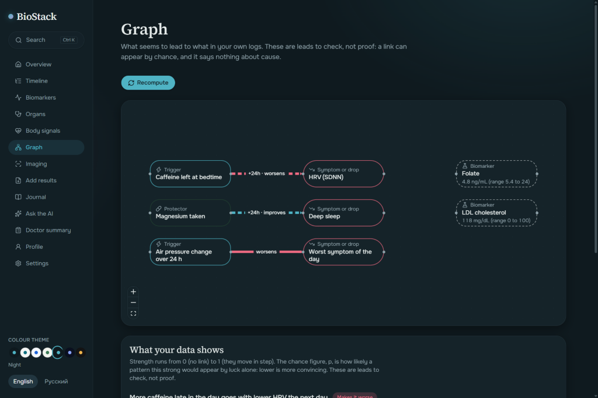
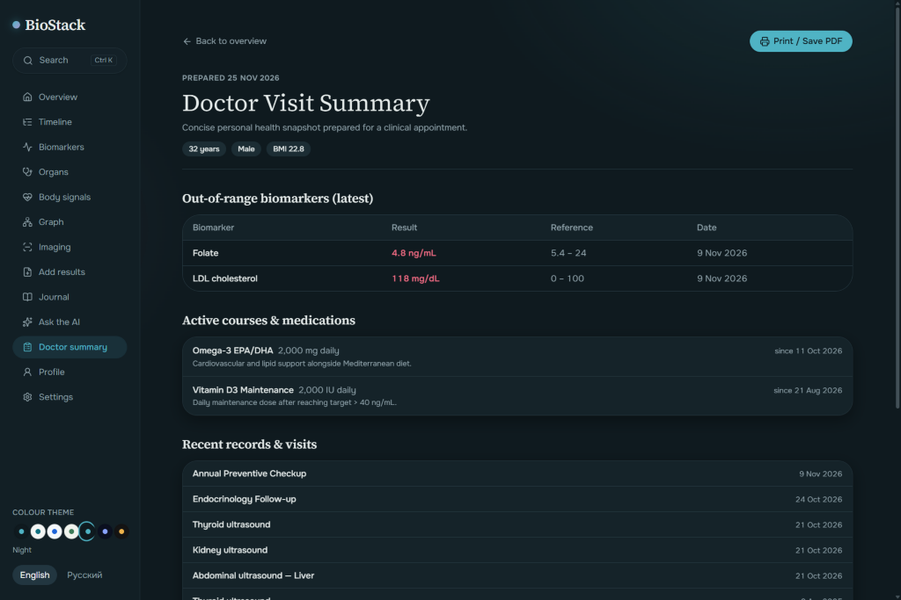

# BioStack

**Private, self-hosted health records, biomarker trends, organ scan history, and wearable signals.**

[](LICENSE)
[](apps/api/pyproject.toml)
[](apps/web/package.json)
[](apps/web/lib/i18n/config.ts)

> [!CAUTION]
> **Not medical advice.** BioStack is a personal record-keeping and data-visualization tool. It does not diagnose conditions, replace clinical judgment, or provide medical advice. Always verify automatically extracted values against your original lab or imaging reports and consult a qualified clinician.

---

## Why BioStack?

- **Local-first & yours forever**: Everything lives in a single SQLite database and a `data/` directory on your machine or home server. Export everything anytime as a portable ZIP (readable CSV/Markdown, JSON, and original files).
- **Deterministic math, nothing invented**: Trends, reference bands, course before/after comparisons, lagged correlations, and wearable baselines are computed directly from stored data. When there is too little data, BioStack says so instead of fabricating scores.
- **Opt-in AI (Cloud or Local)**: Lab PDFs with recognizable tables and ultrasound measurements are parsed locally with deterministic rules first. AI supports **Google Gemini** or any **OpenAI-compatible** endpoint (**Ollama**, **LM Studio**, **OpenAI**, **OpenRouter**) and is used only when you confirm scan uploads or ask questions in **Ask the AI**.
- **Bilingual & themed**: Full **English** and **Russian** UI (`EN` default, switchable in the sidebar) with 6 color themes plus Auto.

---

## Features

| Page | What you get |
| --- | --- |
| **Overview** | First-run onboarding wizard, interactive anatomical body scan, plain-language status, out-of-range markers, body-system tiles, re-test due dates, today's briefing, and latest records |
| **Doctor summary** | Printable clinical visit pack (`/doctor`) with age/sex/BMI snapshot, out-of-range markers, active courses, recent visits, and organ scan history |
| **Timeline** | Every visit, hospital stay, scan, and lab report by year, searchable (`Cmd/Ctrl+K`) in English and Russian with original attachments |
| **Biomarkers** | Grouped by body system with sparklines and range tiers; per-marker time charts with reference bands, visits, courses on the same axis, and before/after diffs |
| **Organs** | Ultrasound findings grouped by organ (thyroid, kidneys, liver, and more): longitudinal charts, scan-to-scan change tables, word-for-word doctor conclusions, and a single-page doctor view |
| **Body & Sleep** | Sleep stages, bedtime/wake-up consistency, resting HR, HRV, skin temperature, SpO2, steps, distance, and workouts from Samsung Health, Apple Health, or phone sync, shown against your rolling 30-day band |
| **Graph** | Lagged correlation graph linking supplements, symptoms, environment (weather/AQI), and wearable metrics once enough days are logged |
| **Imaging** | Upload DICOM ZIP archives, browse keyframes, export frames, and keep structured notes |
| **Add Results** | Multi-file inbox for PDFs and photos (including HEIC preview): tabular lab PDFs parse locally; scans/photos wait for confirmation before AI extraction |
| **Journal** | One-tap supplements, symptoms, notes, treatment courses, and a 10-second CNS tap test |
| **Profile** | Birth date, sex, height, weight & body-composition logs (bioimpedance & smart scale CSV import), BMI trend, and sex/age-aware lab range selection |
| **Ask the AI** | Multi-turn chat (with optional photos and streaming citations) grounded in your record, plus an optional single-user Telegram bot |
| **Settings** | Timezone, location, supplement half-lives, Samsung Health & Apple Health imports, AI provider status & connection test, and one-click ZIP export & empty-DB restore |

---

## Screenshots

<p align="center">
  
</p>

| Biomarker Trends & Courses | Organ Ultrasound History |
| --- | --- |
|  |  |

| Body & Sleep Signals | Lagged Correlation Graph |
| --- | --- |
|  |  |

<details>
<summary>More screenshots: Printable Doctor Visit Summary</summary>



</details>

---

## Quick Start

### Option A: Try Instantly with Demo Data (Docker)

Run a completely isolated demo stack with synthetic data (no API keys required, leaves `./state` untouched):

```bash
docker compose -f docker-compose.demo.yml up --build
```

Open **http://127.0.0.1:3000** in your browser. Data is stored in `./demo-state/`.

### Option B: Local Development

**Prerequisites:** Python 3.13 + [uv](https://docs.astral.sh/uv/), Node.js 22+ + npm.

```bash
cp .env.example .env
# Optional: set GEMINI_API_KEY and GEMINI_MODEL in .env for AI features

printf 'API_BASE_URL=http://localhost:8000\nAPI_SECRET_KEY=change-me\n' > apps/web/.env.local

(cd apps/api && uv sync)
(cd apps/web && npm install)

./scripts/dev.sh   # API on 127.0.0.1:8000, Web on 127.0.0.1:3000
```

> Both servers bind to `127.0.0.1` only, and the Next.js proxy rejects requests whose `Host` or `Origin` is not local or listed in `ALLOWED_HOSTS`.

### Option C: Home Server (Docker + Tailscale + Telegram Bot)

`docker-compose.yml` runs the `api`, `web`, and optional `bot` services with persistent storage in `./state/`. See [`docs/SERVER.md`](docs/SERVER.md) for server setup, Tailscale HTTPS publishing, automated backups, restore, and Telegram bot configuration.

---

## Data Import & Export

- **Lab PDFs & Scans**: Drop files in **Add results**; tabular lab PDFs parse locally, while imaging/scanned reports extract via AI only after confirmation.
- **Samsung Health**: Export your data ZIP from the Samsung Health mobile app and upload it in **Settings**, or import via CLI:
  ```bash
  cd apps/api && uv run python -m scripts.import_samsung_health /path/to/export.zip
  ```
- **Apple Health**: Export your health data ZIP from the Apple Health app on iPhone (`export.xml`) and upload it in **Settings** (`POST /api/v1/imports/apple-health`).
- **Phone Health Sync**: `POST /api/v1/health-sync` (or `/api/health-sync` through the web proxy) accepts iOS Health Auto Export / Health Connect webhook payloads with `X-API-Key: <API_SECRET_KEY>`.
- **Smart Scales**: Import CSV exports on the **Profile** page with a preview step.
- **Notion History**: Optional one-off importer in `apps/api/importers/notion_import.py` (format documented in [`apps/api/importers/SNAPSHOT_FORMAT.md`](apps/api/importers/SNAPSHOT_FORMAT.md)).
- **Full Backup & Restore**: Export a complete ZIP (CSV, Markdown, JSON, original attachments, optional DICOM) from **Settings**, and restore into a fresh empty instance anytime.

---

## AI & Privacy

- **Single-user by design**: BioStack has no multi-tenant cloud backend; it is built to run on your own machine or private tailnet. Set `BIOSTACK_ACCESS_PASSWORD` if you want a password lock screen in front of the web UI.
- **What stays local**: Charts, correlations, risk calculations, Samsung Health & Apple Health parsing, tabular lab parsing, ultrasound rule extraction, and organ history all run locally without AI.
- **Local or Cloud AI (opt-in)**:
  - Run completely offline with `AI_PROVIDER=openai_compat` (for example local **Ollama** or **LM Studio**), or use **Google Gemini**.
  - Uploaded imaging reports/photos are sent once after you confirm and cached by content hash.
  - **Ask the AI** sends your serialized record context and question to your configured provider so it can answer with citations. Leave AI keys/URLs unset if you do not want AI enabled.

---

## Development & Tests

```bash
# Backend test suite
cd apps/api && uv run pytest -q

# Frontend typecheck, lint, and production build
cd apps/web && npx next typegen && npx tsc --noEmit && npm run lint && npm run build
```

To try demo data against a scratch SQLite database outside Docker:

```bash
cd apps/api
uv run python -m scripts.seed_demo --db /path/to/scratch.db --yes
uv run python -m scripts.seed_demo --db /path/to/scratch.db --remove
```

---

## What Should Come Next?

BioStack is shaped by what people actually need for their own health tracking. Planned next milestones include:

- **Garmin & Oura importers** + a generic **CSV/JSON** wearable importer
- **Multi-profile / family support** (track records for partner, kids, or parents in one instance)
- **In-app AI provider & model editor** (switch Ollama / LM Studio / OpenAI / Gemini models from Settings)
- **Merge-style ZIP import** into an existing database

Have an idea, missing lab/wearable format, or feature request?
- **[Vote or share ideas in GitHub Discussions](https://github.com/Green-Blood/biostack/discussions)**
- **[Request a Feature (Issue)](https://github.com/Green-Blood/biostack/issues/new?template=feature_request.md)**
- Full list: [`docs/ROADMAP.md`](docs/ROADMAP.md)

---

## Support, Contributing & Security

- **Support BioStack**: If BioStack saves you time or helps you stay on top of your health, you can **[buy me a coffee](https://strangen.gumroad.com/l/biostack-coffee)** (pay what you want on Gumroad).
- **Contributing**: See [`CONTRIBUTING.md`](CONTRIBUTING.md).
- **Security**: See [`SECURITY.md`](SECURITY.md).
- **License**: [MIT](LICENSE).
